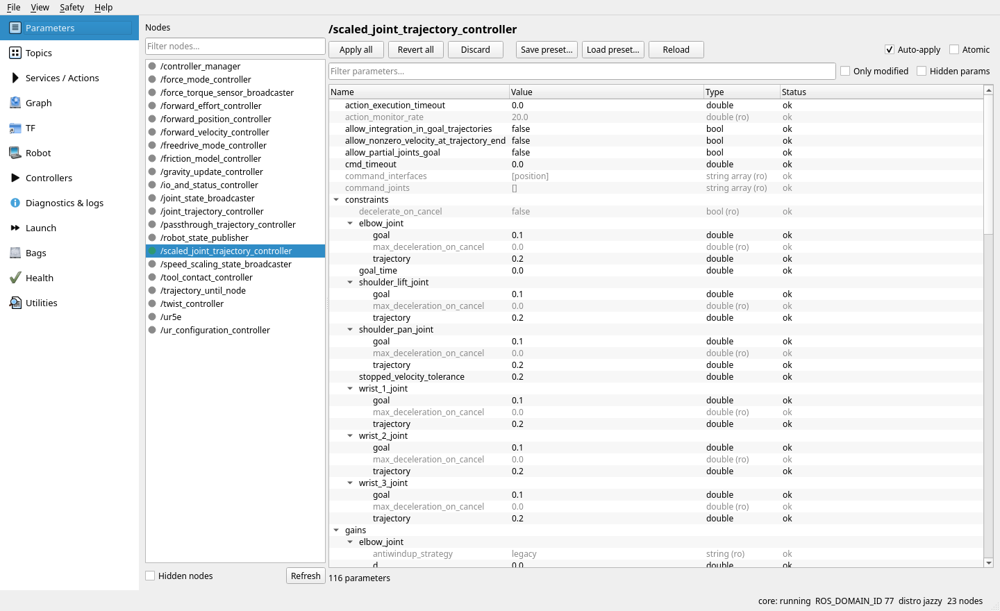

# ros2_robot_dashboard

⚠️ UNDER TESTING PHASE 

A robot-agnostic desktop dashboard for ROS 2, written in Python with PySide6 (Qt 6).
It puts the everyday tools of a robot cell in one window: parameters, topics, services
and actions, the node graph, TF, robot state, `ros2_control`, diagnostics and logs, a
launch manager, rosbag recording and playback, and system health.

Tested on **Humble**, **Jazzy** and **Lyrical** (RoboStack/pixi and colcon workspaces).



## Features

| Page | What you can do |
|---|---|
| Parameters | Browse all nodes; edit typed values with range-aware editors; auto-apply or apply in batch (optionally atomic); see changes made by others; save/load presets; extra confirmation for critical parameters |
| Topics | Rates, bandwidth, publishers/subscribers with QoS and QoS-mismatch detection; rate-limited echo; record an echo to file |
| Services / Actions | Call services and send action goals from a form generated from the interface definition (or YAML); see feedback and result; cancel goals |
| Graph | Node/topic graph with filters (debug topics, hidden nodes, dead ends, isolated nodes, namespace, neighbours); Graphviz layout; export PNG/SVG/DOT |
| TF | Frame tree with rates and problems (multiple parents or roots, loops, stale frames); `tf2_echo` with quaternion, RPY (rad/deg) or SE(3) output |
| Robot | Joint positions with limit bars; URDF summary; pose between any two frames |
| Controllers | `ros2_control` controllers, hardware interfaces and components; activate/deactivate/switch with a preview of claimed interfaces and conflicts |
| Diagnostics & logs | `/rosout` with level/node/regex filters; `/diagnostics` tree with history; lifecycle nodes and transitions |
| Launch | Launch profiles with typed arguments and presets; start/stop/restart with clean shutdown (SIGINT → SIGTERM → SIGKILL) and leftover detection; multi-step scenarios |
| Bags | Record (topics, split, compression, storage) and play (rate, loop, clock, pause) |
| Health | Critical topics against expected rates; CPU/memory/network of this PC and of robot PCs running `host_monitor`; discovery problems |
| Utilities | Live plot of numeric fields; compare the parameters of two nodes, or of a node and a preset |

Other features: global search (Ctrl+K), read-only mode, confirmation of risky actions,
an action log, and light and dark themes.

## Installation

### RoboStack / pixi (recommended)

The dashboard needs PySide6 and pyqtgraph, which RoboStack environments provide through
conda-forge:

```bash
pixi add pyside6 pyqtgraph psutil pyyaml graphviz
cd src && git clone <this repository> ros2_robot_dashboard && cd ..
pixi run colcon build --symlink-install --packages-select ros2_robot_dashboard
pixi run ros2 run ros2_robot_dashboard robot_dashboard
```

### apt-based ROS 2

```bash
sudo apt install python3-psutil python3-yaml graphviz
pip install --user "PySide6>=6.5" pyqtgraph       # not packaged by rosdep on every distro
cd ~/ros2_ws/src && git clone <this repository> ros2_robot_dashboard
cd .. && rosdep install --from-paths src --ignore-src -y
colcon build --packages-select ros2_robot_dashboard && source install/setup.bash
ros2 run ros2_robot_dashboard robot_dashboard
```

### Command line

```
ros2 run ros2_robot_dashboard robot_dashboard [--read-only] [--config FILE]
        [--page PAGE] [--theme light|dark] [--distro NAME] [--version]
ros2 run ros2_robot_dashboard host_monitor     # on each robot PC (Health page)
```

## Documentation

- [User guide and tutorials](docs/user_guide.md), with screenshots of every page,
  using a UR robot with mock hardware.
- [Configuration](docs/configuration.md): settings, launch profiles, health profiles, presets.
- [Architecture and development](docs/architecture.md): design, tests, CI.

## Development

The repository has its own pixi manifest with one environment per distro. You can run
the tests without a colcon workspace:

```bash
pixi run -e jazzy test       # also: -e humble, -e lyrical
pixi run -e jazzy lint
pixi run -e jazzy dashboard
```

GitHub Actions runs lint and the full test suite (unit, ROS and Qt offscreen) on
Humble, Jazzy and Lyrical. `tools/ur_cell_tour.py` is an end-to-end check against a
UR mock-hardware cell. It also regenerates the screenshots in `docs/images`.

## Notes

- **Fontconfig in conda/pixi.** Inside a conda environment the dashboard gives
  fontconfig a private cache directory. This avoids a crash when the environment's
  fontconfig reads a cache written by a different system version. Set
  `qt.private_font_cache: off` to disable this.
- **Executor.** The dashboard node uses rclpy's single-threaded executor. In Python,
  `MultiThreadedExecutor` is about 20 times slower and cannot keep up with a 500 Hz
  `/joint_states` topic. Blocking work runs in a worker pool, not in callbacks.

## License

Apache License 2.0, see [LICENSE](LICENSE).
The dashboard uses PySide6 (LGPLv3) and pyqtgraph (MIT) as unmodified, dynamically
linked dependencies. They are not distributed with this repository.

## AI disclaimer

LLM tools, including Claude, have been used to help write the code in this repository.
All code was reviewed by humans, and the authors take full responsibility for its
correctness.
