# User guide

This guide walks through every page of the dashboard using a Universal Robots arm
with **mock hardware**, so you need no real robot. The screenshots come from ROS 2
Jazzy. Humble and Lyrical look the same, though some controller names differ.

## Before you start

Install the UR driver and `ros2_control` in your workspace. With pixi:

```bash
pixi add ros-jazzy-ur ros-jazzy-ros2-control ros-jazzy-ros2-controllers
```

Then start the dashboard:

```bash
ros2 run ros2_robot_dashboard robot_dashboard
```

The left column lists the pages. The status bar shows the core state, `ROS_DOMAIN_ID`,
the detected distro, the node count, a button for recent errors, and a **READ-ONLY**
badge when write actions are disabled (*Safety → Read-only mode*, or `--read-only`).

Press **Ctrl+K** anywhere to search nodes, topics, services, actions, parameters and
frames, then jump to the right page.

## Tutorial 1: start the cell from the Launch page

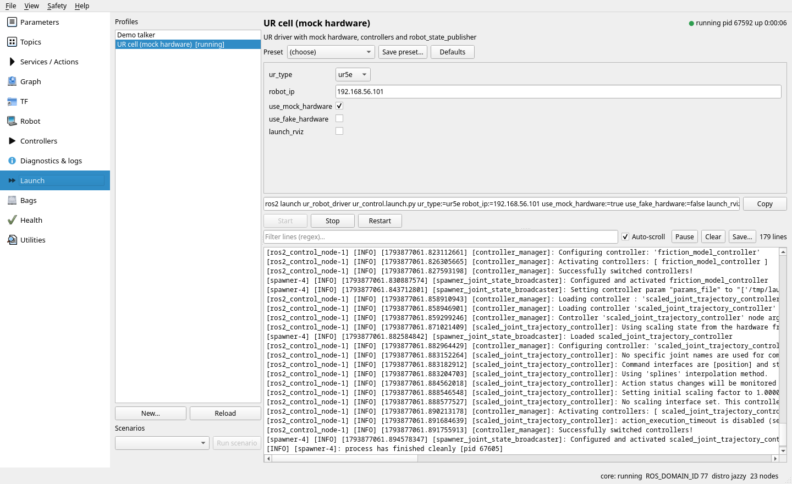

1. Open **Launch** and select the example profile **UR cell (mock hardware)**.
2. Check the arguments. Each one has a typed widget (choice, bool, string, number).
   The checkbox next to the name says whether the argument is **passed**. Unticked
   arguments are left out of the command line, so the launch file uses its own default.
   In the example profile `use_fake_hardware` (the Humble name of the mock option) starts
   unticked: tick it on Humble, and untick `use_mock_hardware` there. In your own profiles,
   write `use_default: true` for the arguments that should start unticked (see
   [Configuration](configuration.md#launch-profiles)). **Hide unticked arguments**
   shows only the arguments that are passed; the label next to it counts the hidden ones.
3. The command line below the form shows exactly what will run. Click **Copy** to use
   it in a terminal.
4. Click **Start**. The output appears live, and the profile shows `[running]`.

**Stop** sends SIGINT, then SIGTERM and SIGKILL if the process does not exit within the
profile's timeouts. Afterwards the page checks for leftover child processes, and
**Kill leftovers** removes them. **Save preset…** stores the current argument values,
including which ones are not passed. **New…** creates a profile and can import the
arguments of a launch file (`ros2 launch --show-args`). Arguments whose default is a
launch expression (for example `LocalVar('FindPackageShare(...)')`) are imported with
`use_default: true`. Scenarios start several profiles in order and wait for a
node or service between steps.

When you close the window while processes are running, the dashboard asks whether to
leave them running or stop them.

## Tutorial 2: tune controller parameters

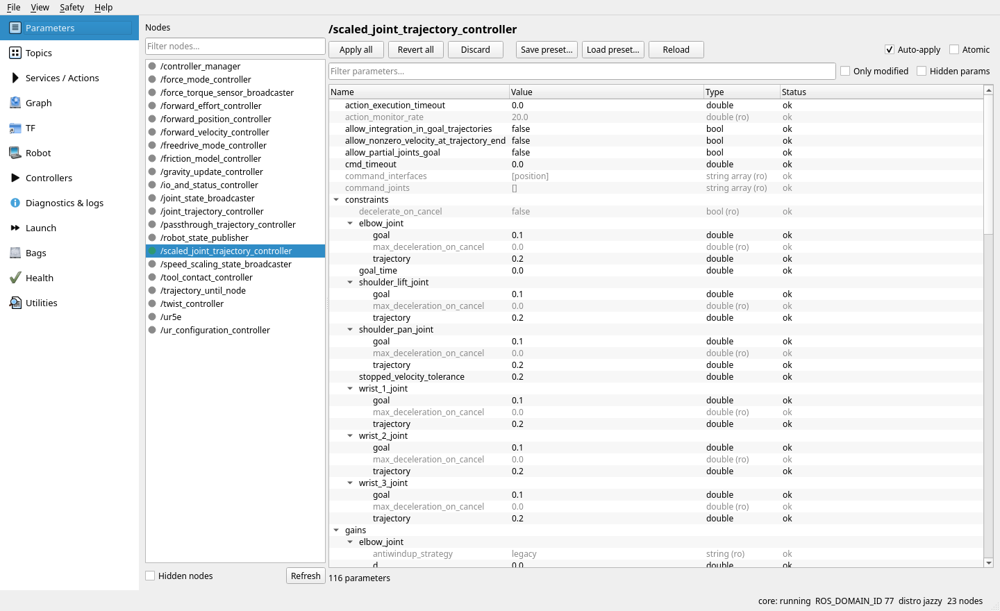

1. Open **Parameters** and pick `/scaled_joint_trajectory_controller`.
2. Parameters are grouped by their dotted prefix (`constraints.elbow_joint.goal` and so
   on). Read-only parameters are grey.
3. Double-click a value to edit it. Numbers with a declared range get a slider, and
   arrays open an editor.
4. With **Auto-apply** on, the value is sent after a short pause. With it off, edited
   rows are marked *modified* until you click **Apply all**. Check **Atomic** to apply
   all of them together, or none.
5. If another tool changes a parameter you are editing, the row shows a conflict.
   Right-click it to choose **keep mine** or **accept external**.

**Save preset…** writes the parameters to YAML (in `$ROS_HOME/robot_dashboard/param_presets`
by default). **Load preset…** marks the differences as modified so you can review
them before applying. Parameters listed in `params.critical` need a second confirmation.

## Tutorial 3: inspect topics

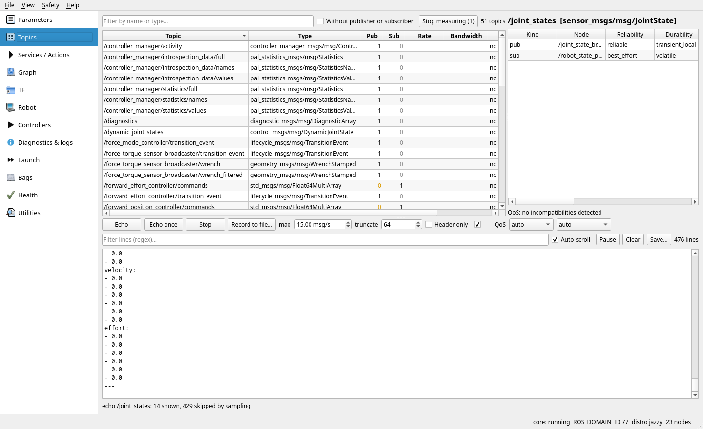

- The table lists every topic with its type and publisher and subscriber counts.
  Select topics and click **Measure rate** to add rate and bandwidth.
- Selecting a topic shows each endpoint with its QoS. QoS mismatches (for example a
  best-effort publisher and a reliable subscriber) are reported below.
- **Echo** prints messages, sampled at most at *max* msg/s, so even 500 Hz
  `/joint_states` stays readable. Long arrays are truncated. **Header only** and the
  QoS choice help with large or special topics.
- **Record to file…** saves every message as YAML text, without sampling or truncation,
  optionally with receive time and `header.stamp`, and with a message or time limit.

## Tutorial 4: call services and send action goals

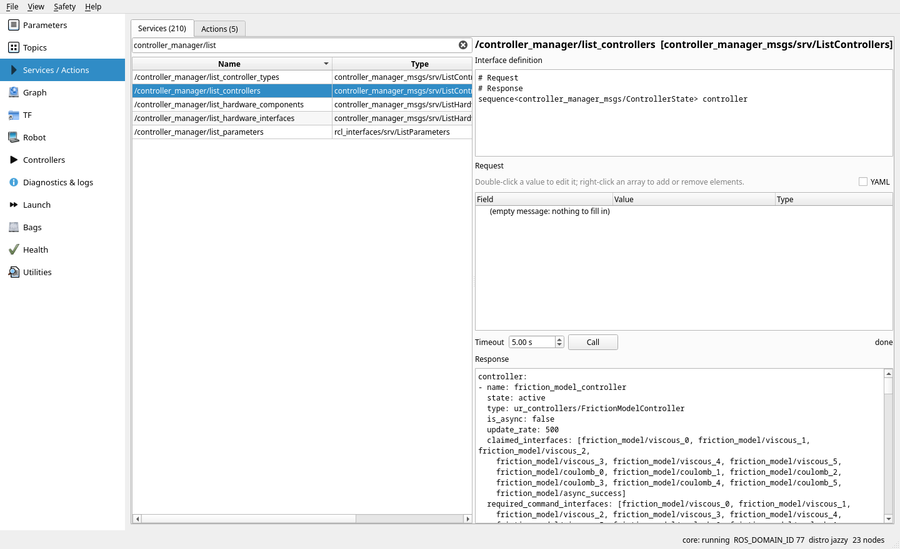

Select a service. The page shows its definition and a request form generated from it.
Fill the fields (or switch to **YAML**) and click **Call**. The response appears below.
Calls to services whose name looks risky (`stop`, `reset`, `switch`…) ask for
confirmation first.

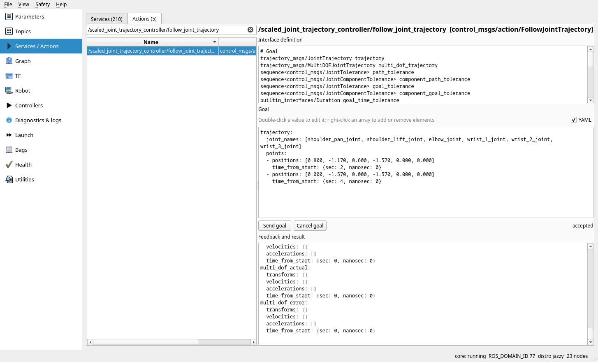

Actions work the same way. In this example a `FollowJointTrajectory` goal is sent to
`/scaled_joint_trajectory_controller/follow_joint_trajectory`. Feedback messages
stream into the lower panel, followed by the result. **Cancel goal** cancels the goal.

## Tutorial 5: plot the motion

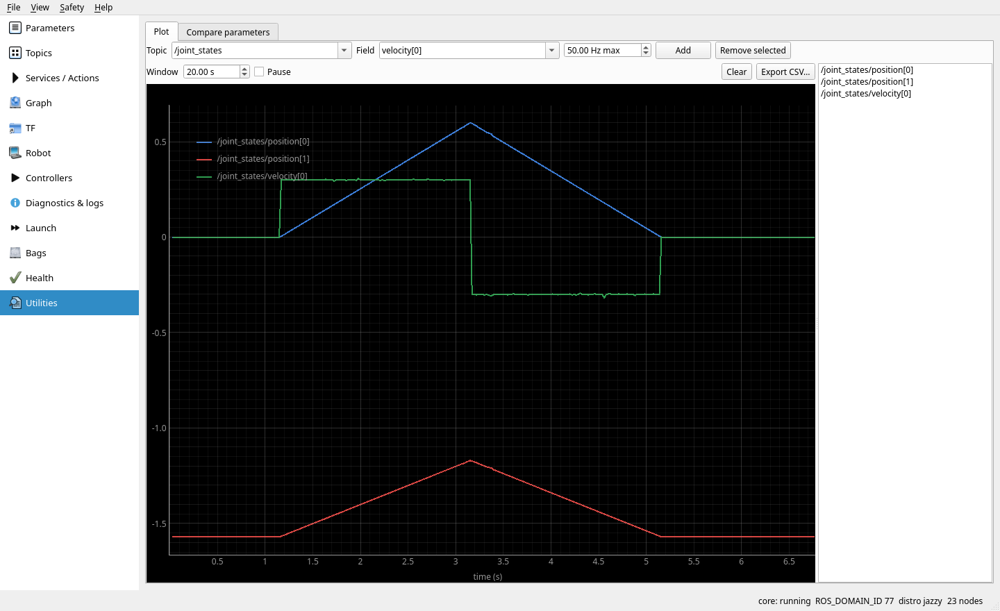

In **Utilities → Plot**, choose a topic and a numeric field (`position[0]`,
`velocity[0]`…) and click **Add**. The plot above was recorded while the goal from
Tutorial 4 moved two joints. **Export CSV…** saves the visible data. **Compare
parameters** shows the differences between two nodes, or between a node and a preset
file.

## Tutorial 6: robot state and TF

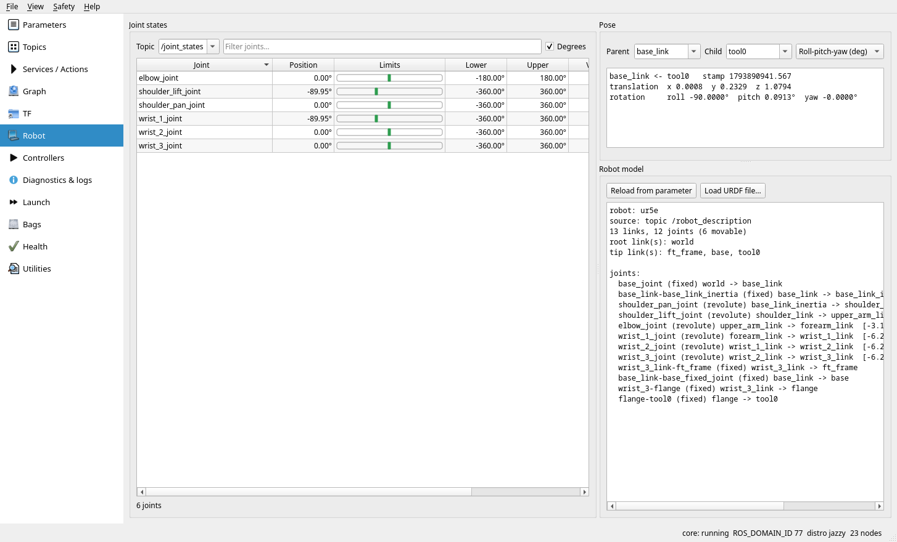

**Robot** shows each joint with a bar between its URDF limits. Joints close to a limit
are highlighted. **Degrees** switches the units. The right side summarises the URDF from
`/robot_description` and shows the pose of a *child* frame in a *parent* frame.

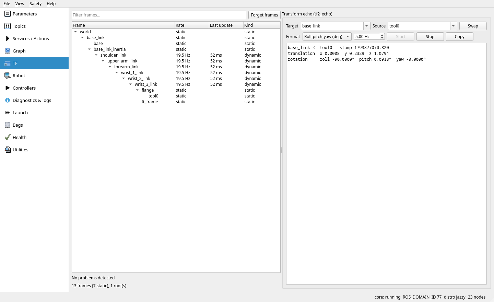

**TF** opens on the **Graph** tab: the frame tree drawn from the root down, like
`view_frames`, but live. Each arrow goes from parent to child and shows the publishing
rate; static transforms are dashed and grey, frames with problems have a red border, and
a parent that was never received has a dashed border. Hover a frame for its parent, rate
and last update.

- **Click** a frame to make it the echo *source*.
- **Double-click** it to echo it in its parent frame.
- **Right-click** to set it as target or source, or to echo it in the current target.
- Zoom with the wheel and drag to pan. **Fit** shows the whole tree. **Export…** writes
  PNG, SVG or DOT. Type a frame name in the filter and press Enter to find it.

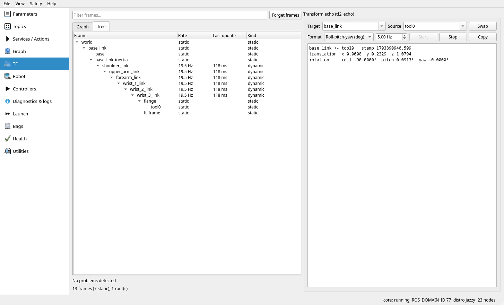

The **Tree** tab lists the same frames as text, with rate, age of the last update and
kind. Problems are listed below: multiple parents or roots, loops, and stale frames.
To echo a transform, pick the target and source frames and a format: quaternion, RPY in
radians or degrees, or a 4×4 SE(3) matrix. **Swap** inverts the transform.

## Tutorial 7: switch controllers

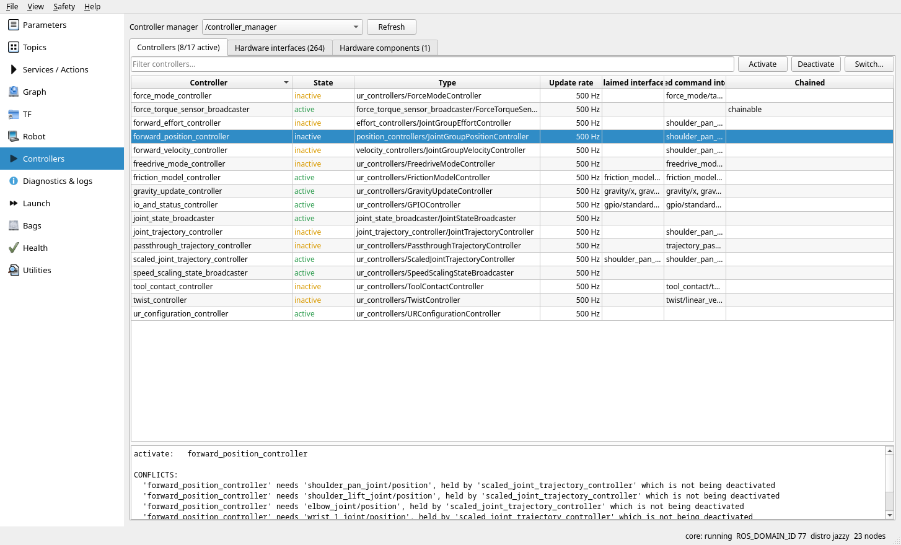

**Controllers** lists the controllers of the selected controller manager with their state,
type, update rate and claimed interfaces. Selecting an inactive controller previews what a
switch would do: which interfaces it claims, and which active controllers conflict with it.

**Switch…** opens a dialog to activate and deactivate several controllers in one step
(strict or best-effort, with a timeout). The tutorial run swaps
`scaled_joint_trajectory_controller` for `forward_position_controller` and back.
Right-click a controller to configure, unload or clean it up, or to open its parameters.

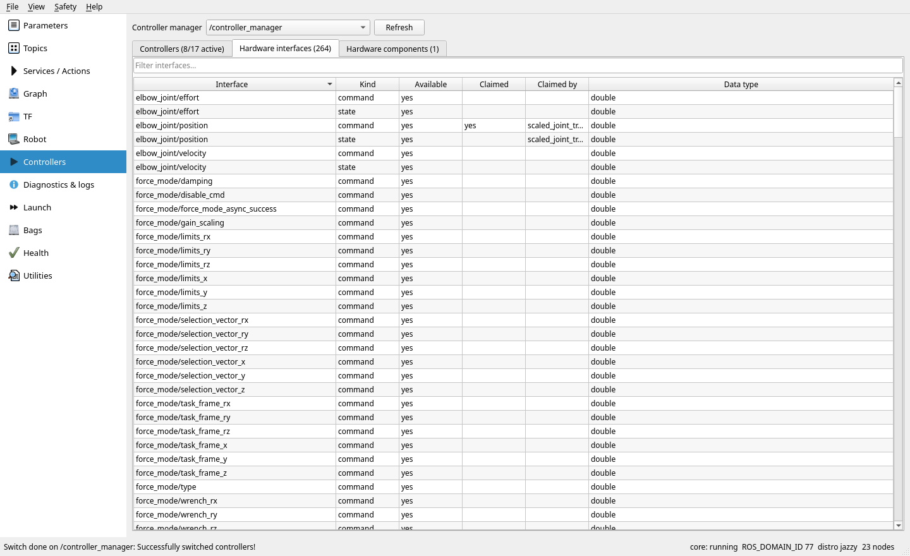

The **Hardware interfaces** and **Hardware components** tabs show every interface with
its claim status, and let you change a component's lifecycle state.

## Tutorial 8: graph

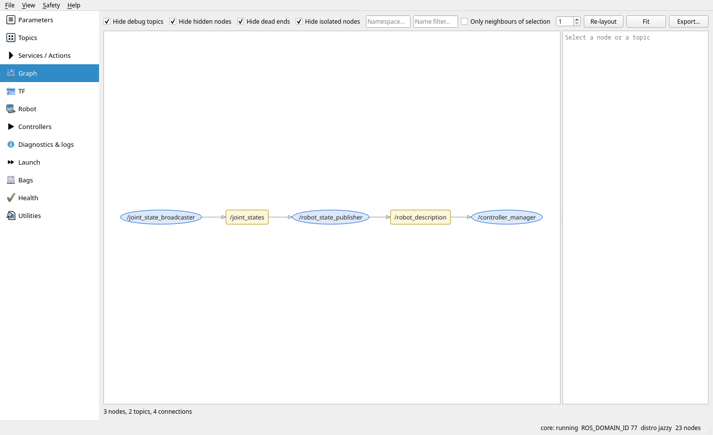

**Graph** draws nodes (ellipses) and topics (boxes). By default it hides debug topics,
hidden nodes, topics with only one side, and nodes left without connections. Untick
these options to see everything. Use **Only neighbours of selection** to focus on one
node. You can drag nodes, and their positions are remembered. **Export…** writes PNG,
SVG or DOT.

## Tutorial 9: logs, diagnostics, lifecycle

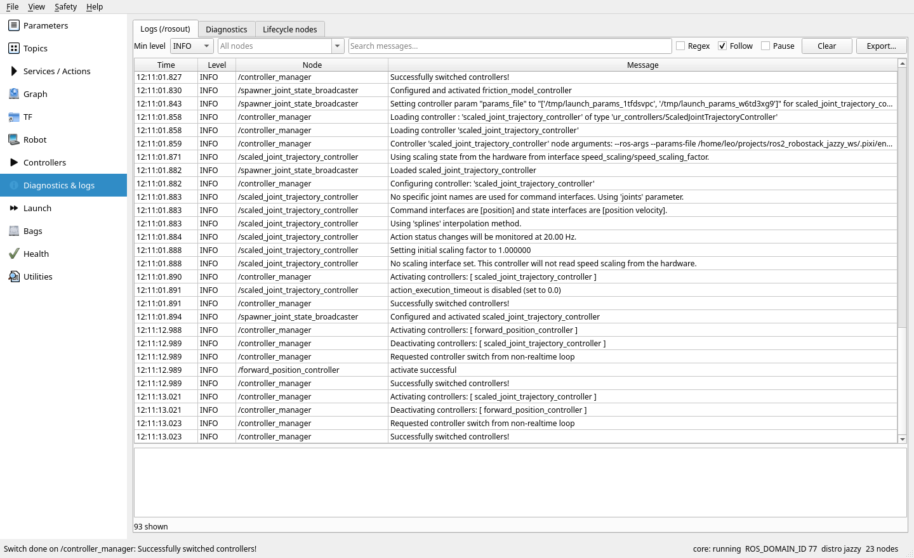

The **Logs** tab is a `/rosout` console inspired by
[swri_console](https://github.com/swri-robotics/swri_console).

**Loggers (left).** Every logger seen on `/rosout` appears in a tree: a node's logger
(`controller_manager`) and its child loggers (`controller_manager.resource_manager`).
The counts include the children. Select one or more loggers (Ctrl/Shift-click) to show
only their messages, children included. **All** clears the selection.

**Logger levels.** Right-click loggers and choose **Set logger level** → DEBUG, INFO,
WARN, ERROR or FATAL. The *Level* column shows the level set on each logger, or
*inherit* when it follows its parent. In the screenshot `controller_manager` was set to
DEBUG, and its debug messages appear at once. Setting a node's logger also changes its
child loggers that have no level of their own. **Set level of a child logger…** sets a
child logger that has not logged anything yet.

This uses the `get_logger_levels`/`set_logger_levels` services, which exist from ROS 2
Iron and only in nodes created with `enable_logger_service` (`rclcpp::NodeOptions()
.enable_logger_service(true)`, or `Node(..., enable_logger_service=True)` in Python).
`ros2_control` nodes have them on Jazzy and newer: the controller manager and every
controller of the UR cell. When a node does not offer them, the menu says why. On Humble
the services do not exist, and the child loggers of Python nodes do not publish to
`/rosout`.

**Messages (right).**

- Severity checkboxes (Debug is hidden by default).
- **Include** and **Exclude** filters on the message text, plain or **Regex**.
- **Time**: time of day, date and time, relative to the first message, or ROS stamp.
- **Columns**: logger, location (`file:line`), function. **Colors** colours rows by
  severity. Right-click a logger and choose **Color…** to give its messages a background.
- **Follow** keeps the newest message visible. **Pause** freezes the list (messages are
  still collected).
- Select rows and press Ctrl+C to copy them. Right-click for *copy with location*,
  *only this logger*, *exclude messages like this*, and the logger level.
- **Save…** writes the shown messages as text or JSON lines. **Load…** reads them back,
  or reads `/rosout` from a rosbag2 (folder, `.mcap` or `.db3`).

The **Diagnostics** tab groups `/diagnostics` statuses by name prefix (`prefix: item`)
and keeps a short history for each status. **Lifecycle nodes** lists managed nodes and
triggers their transitions.

## Tutorial 10: health

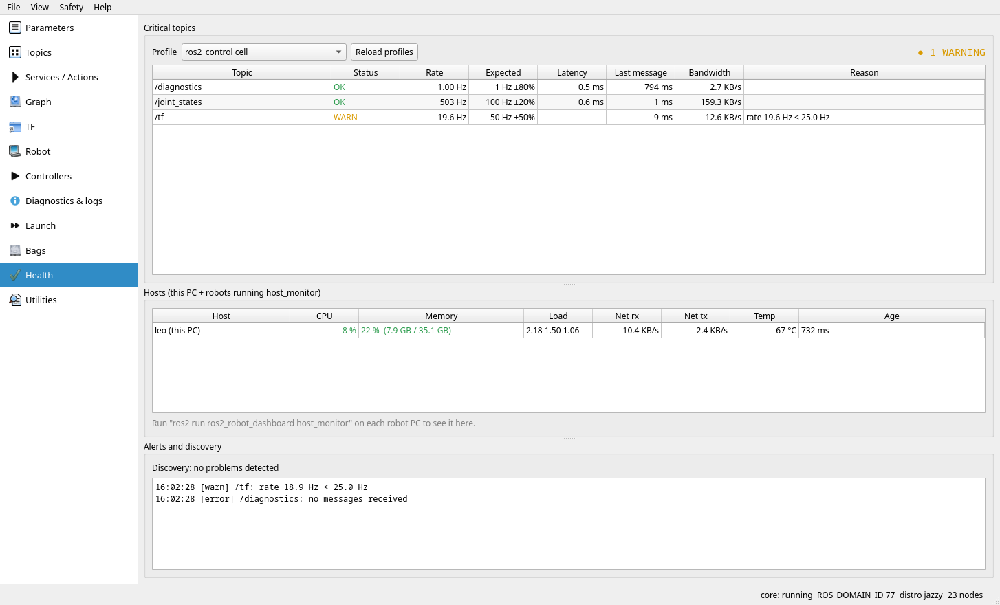

A *health profile* lists critical topics with their expected rate, tolerance and
timeout. The example profile `ros2_control cell` checks `/joint_states`, `/tf` and
`/diagnostics`. A row turns yellow or red when the rate is too low or messages stop,
and the event is logged under **Alerts**.

The host table shows CPU, memory, load, network and temperature of this PC. To add robot
PCs, run this on each one:

```bash
ros2 run ros2_robot_dashboard host_monitor
```

## Tutorial 11: bags

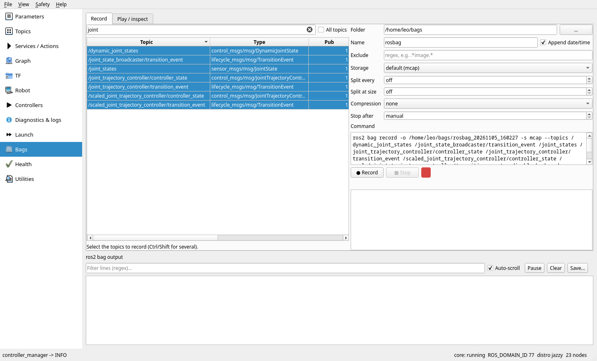

**Record** lets you choose topics (or all), the storage format, compression and split
size. The command preview shows the `ros2 bag record` command that will run. The page
warns before recording heavy topics such as images and point clouds. **Play** shows a
bag's info and plays it with rate, loop and `/clock` options. You can pause and resume
playback.

## Dark theme

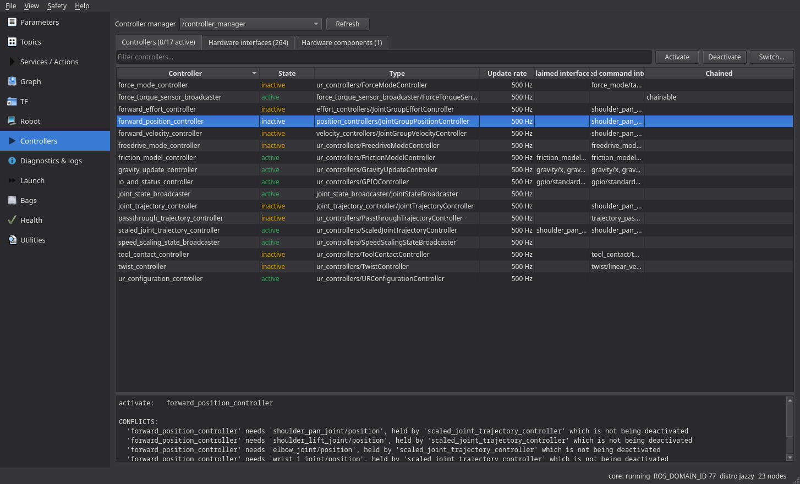

Use *View → Dark theme* or `--theme dark`.

## Safety

- **Read-only mode** disables every widget that writes to the robot.
- **Confirmations**: risky services, controller switches, critical parameters, and
  stopping processes ask first (`confirm_actions: false` disables them).
- **Action log**: every write action is appended to
  `~/.local/state/ros2_robot_dashboard/actions.log` (*Safety → Action log*).
